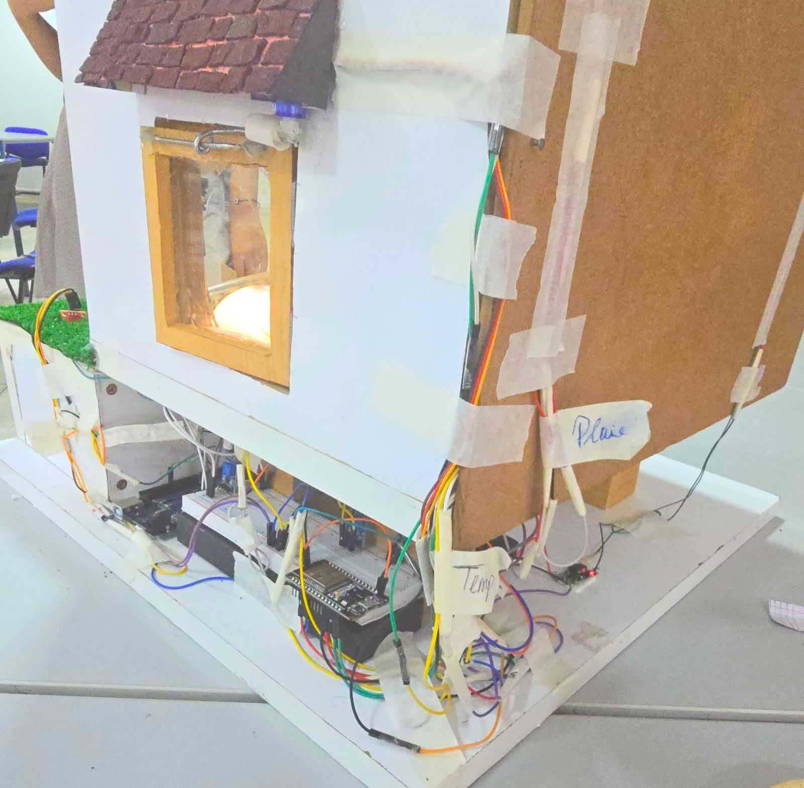

# 🏠 Smart Eco Home – IoT Automation System

An intelligent, connected smart home system designed to **monitor environmental conditions**, **optimize resource usage**, and **automate home responses** using embedded systems and a real-time web dashboard.

---

## 🎥 Demo & Links

- 🎬 **Project Demo Video:**  
  [youtube-link](https://www.youtube.com/watch?v=ehRXi9BCrfc)

- 🌐 **Web Platform:**  
  [platform-link](https://maison-intelligent-7b24c.web.app/)

- 🏠 **3D House Model:**  
  [3d-preview-link](https://www.tinkercad.com/things/6Bf62OLmD8W-smart-eco-home?sharecode=J0_OHOvDgKxUs6OSRgnVhUUI_51MK_4sZE4ex9nbF0w)

---

## 📸 Project Preview

### 🌐 Web Dashboard

---

### 🔧 Hardware Prototype
  

---

## 🧠 System Overview

This system integrates **sensors, automation logic, and cloud connectivity** to create a fully interactive smart home.

### ⚙️ Architecture

---

## 📲 Web Application

### ✨ Features
- Live sensor data updates  
- Smooth animated charts (Chart.js)  
- Interactive UI controls  
- Real-time Firebase synchronization  

### 🧑‍💻 Technologies
- **Frontend:** HTML, CSS, JavaScript  
- **Visualization:** Chart.js  
- **Backend:** Firebase Realtime Database  

---

## 🔧 Hardware Components

- ESP32 (Wi-Fi + main controller)  
- DHT11 (Temperature & Humidity)  
- MQ-5 (Gas detection)  
- Rain sensor  
- Water level sensor  
- Servo motor (window control)  
- LEDs (lighting system)  

---

## 🚀 Core Features

### 🌡️ Environmental Monitoring
- Real-time **temperature** and **humidity** tracking  
- Live data visualization with dynamic charts  
- Instant updates via Firebase  

---

### ⚠️ Air Quality & Safety
- **MQ-5 Gas Sensor** detects harmful gases  
- Automatic response:
  - 🪟 Window opens immediately for ventilation  
- Real-time alerts on dashboard  

---

### 🌧️ Weather Awareness
- Rain sensor detects precipitation  
- Smart reaction:
  - 🌧️ Rain detected → Window closes automatically  

---

### 🪟 Smart Window Automation

Priority-based decision system:

1. **Gas detected** → Window OPEN  
2. **Rain detected** → Window CLOSED  
3. **Temperature > 30°C** → Window OPEN  
4. **Normal conditions** → Window CLOSED  

---

### 🚰 Water Level Monitoring
- Tank level displayed as **percentage**  
- Visual representation on dashboard  
- Status levels:
  - 🔴 Critical  
  - 🟡 Low  
  - 🟢 Normal  

---

### 💡 Smart Lighting Control
- Control 3 rooms:
  - Kitchen  
  - Bedroom  
  - Living Room  
- Real-time ON/OFF via web interface  
- Instant synchronization with ESP32  

---

## 🔄 System Workflow

1. ESP32 reads sensor data  
2. Data is sent to Firebase  
3. Web app updates instantly  
4. User interacts with dashboard  
5. Commands sent back to ESP32  
6. Hardware responds in real time  

---

## 👨‍💻 Author
- Marwane Haddane
- GitHub: https://github.com/Marwane-Haddane
